# buzzcut ✂

**Your coding agent ran `cat .env` once. Your keys are still in its logs, in plain text.**

buzzcut finds them, tells you which ones still work, and cuts them out.
Supports **Claude Code** and **Codex**.

<p>
  
  
  
</p>

<p align="center">
  
</p>

## The problem

Coding agents save every session to disk, including everything a tool prints. When the agent reads your `.env` to debug something, your keys go into that log.

- The logs are not in your repo. `.gitignore` doesn't cover them, and the secret scanners that watch your repo never look there.
- They stay around. Claude Code keeps them for 30 days by default. Mine go back five months.
- The keys were also sent to the model.

On my laptop buzzcut found **188 secrets in Claude Code logs and 125 in Codex logs**.

See for yourself. Nothing to install:

```
git clone https://github.com/akzh4n/buzzcut
python3 buzzcut/scripts/buzzcut.py scan
```

## What it does

```
scan    find keys in the logs           read-only, never prints a key
check   which keys still work           asks the provider, only with --yes
clean   cut keys out of the logs        dry run first, always backs up
hook    stop new keys from reaching     Claude Code only
        the model and the log
```

## Example

**The hook.** The agent runs `cat .env`. The model gets back:

```
NODE_ENV=production
OPENAI_API_KEY=***REDACTED by buzzcut: openai***
DB_PASSWORD=***REDACTED by buzzcut: env_secret***

✂ buzzcut: 2 secrets cut from Bash output
```

The command still works. The key never reaches the model or the log.

**scan** finds what is already there:

```
  buzzcut — Claude Code 11 · Codex 3

  FOUND    11 unique · 39 occurrences · 14 files

  BY AGENT
    Claude Code          8 uniq.     30 occ.
    Codex                3 uniq.      9 occ.

  BY TYPE
    ENV secret           3 uniq.     11 occ.
    URL credentials      2 uniq.      9 occ.
    OpenAI               1 uniq.      6 occ.
    GitHub PAT           2 uniq.      6 occ.
    ...
```

**check** tells you what to rotate first:

```
  LIVE — rotate now
    OpenAI          sk-proj-…isAj     api
    GitHub PAT      ghp_…FfkC         web
    GitHub PAT      ghp_…z9CP         bot

  DEAD — 1, already rotated, just clean them out

  TOTAL   3 live · 1 dead · 7 to judge
```

<sub>Fake keys in a demo folder.</sub>

## Supported agents

| | scan | check | clean | hook |
|---|:-:|:-:|:-:|:-:|
| Claude Code | ✓ | ✓ | ✓ | ✓ |
| Codex | ✓ | ✓ | ✓ | |

Codex remembers byte offsets into its logs and keeps a second copy of every session in its own database. So in Codex, `clean` replaces each key with asterisks of the same length, in the logs and in the database copies, and only while Codex is closed. Codex's hooks can't rewrite a command's output, so there is no hook for Codex.

Other agents (Cursor, Gemini CLI, Cline, Windsurf) aren't supported yet. PRs welcome.

## Install

**Claude Code plugin.** Adds the hook and the `/buzzcut:scan`, `/buzzcut:check` and `/buzzcut:clean` commands:

```
/plugin marketplace add akzh4n/buzzcut
/plugin install buzzcut@buzzcut
```

If it asks for a scope, pick user: the hook only protects the projects where the plugin is installed.

**Without the plugin.** Python 3, no dependencies:

```
git clone https://github.com/akzh4n/buzzcut
python3 buzzcut/scripts/buzzcut.py scan
```

Installed 0.1.1? Update. Its hook didn't load.

## FAQ

**Why not trufflehog?**
It's great at finding and verifying keys. If you have it, run it on these folders too. buzzcut adds the hook, which stops new leaks, and `clean`, which removes old ones. It's under 1,000 lines of plain Python you can read before running.

**Why not just grep?**
The logs are JSONL. A whole `.env` dump sits on one line with newlines escaped as `\n`, so a regex looking for `NAME=value` sees `\nDB_PASSWORD` as one word and misses every variable after the first.

**Does it send my keys anywhere?**
Only `check` does, only with `--yes`, and only to each key's own provider.

**Is cleaning enough?**
No. The key already reached the model. Rotate it. And once you've checked that everything works, delete `~/.buzzcut-backup`: it still holds the keys.

## Limits

- The hook covers Bash, Read, Grep and Glob. It doesn't see MCP tools, failed commands, or keys you paste yourself.
- Claude Code also keeps copies of the files the agent edited (`~/.claude/file-history`) and your prompt history. Those aren't scanned yet.
- Detection is a heuristic: OpenAI, Anthropic, GitHub, AWS, Google, Slack and Telegram tokens, JWTs, private keys, database URLs, and variables named like `*_SECRET`, `*_TOKEN` or `*_PASSWORD`.

MIT
